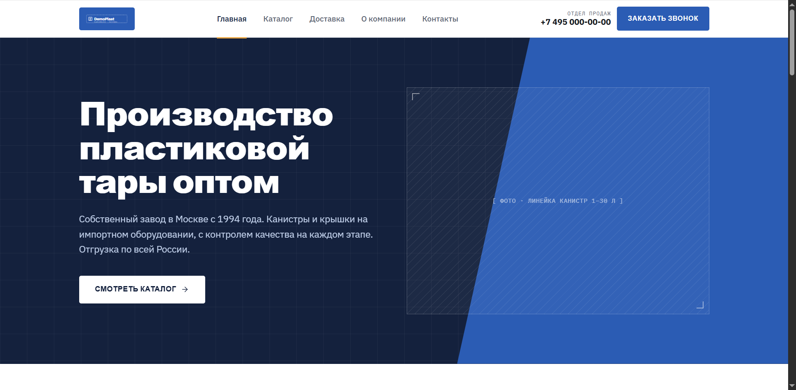
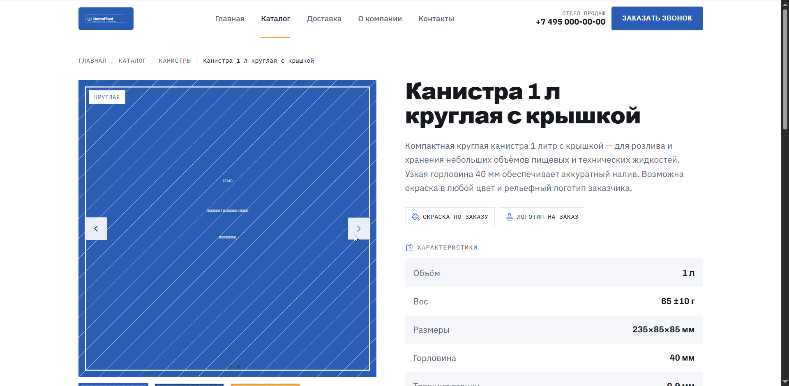
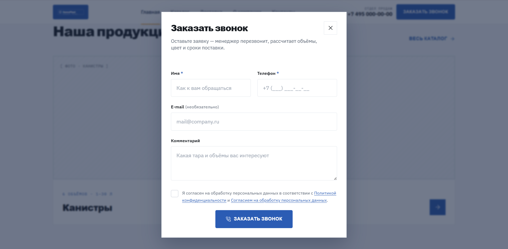
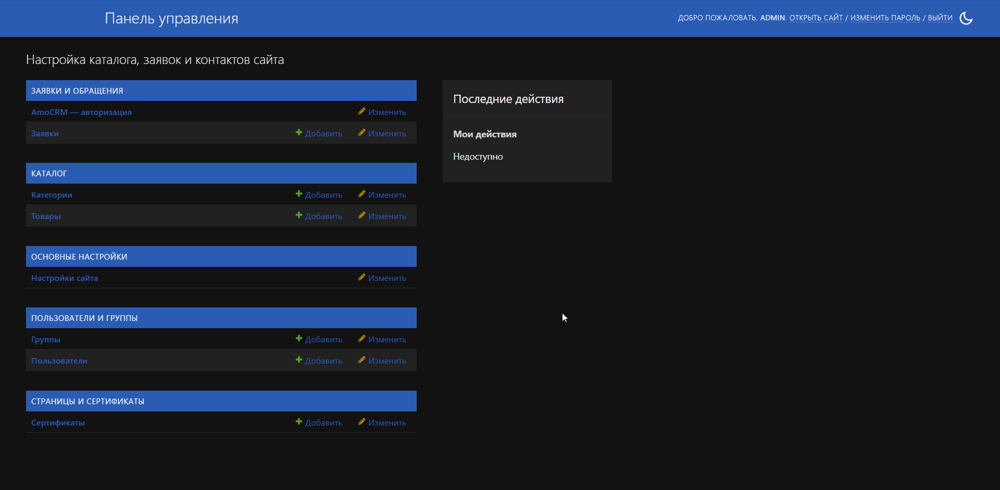

# DemoPlast

> Server-rendered catalog and lead-generation site for a plastic packaging manufacturer, built on Django 5.

[](https://github.com/Skerter/django-plastic-landing/actions/workflows/test.yaml)
[](pyproject.toml)
[](pyproject.toml)
[](LICENSE)

**Live demo:** [demoplast.skerter.dev](https://demoplast.skerter.dev) ·
**Docs:** [skerter.github.io/django-plastic-landing](https://skerter.github.io/django-plastic-landing/) ·
**Language:** English · [Русский](README.ru.md)

A six-page product catalog with HTMX-driven lead forms, a fan-out notification pipeline
(email, Telegram, amoCRM), and Russian personal-data law (152-FZ) compliance built into the
form flow. It runs locally with a single `docker compose up` and seeds its own demo content;
production runs on a VPS behind Traefik with automated deploys from CI.

This repository is an anonymized showcase of a real commercial project. Client data is
replaced by a fictional company, "DemoPlast" — the architecture and engineering decisions are
intact, the customer is not disclosed.

---

## Screenshots

| Home | Product page |
|---|---|
|  |  |

| Lead form | Admin |
|---|---|
|  |  |

---

## Engineering highlights

**Lead hits the database first, CRM second.** The local database is the source of
truth: the lead is written before any outbound call, and the amoCRM push runs asynchronously
afterwards. A CRM outage or an expired OAuth token never loses a submission and never blocks
the response. ([ADR-0005](docs/adr/0005-write-lead-to-db-first.md),
[apps/leads/views.py](apps/leads/views.py), [apps/leads/tasks.py](apps/leads/tasks.py))

**Isolated notification channels.** Email, Telegram and amoCRM run as three independent
django-q2 tasks with native retries; one failing channel does not affect the others. Channels
are toggled from the admin, and a disabled channel is never queued.
([apps/leads/services/](apps/leads/services/))

**152-FZ compliance.** Privacy policy and consent form are separate documents, as the law
requires. The consent checkbox is never pre-checked and is validated server-side; the consent
fact is stored with a timestamp. Analytics are not loaded until cookie consent is given
(decided server-side in the template), and only name and phone are collected. A Sentry
`before_send` scrubber strips names, phones and form bodies before events leave the process.
([config/sentry.py](config/sentry.py), [explanation](docs/explanation/compliance-152fz.md))

**Form hardening.** Honeypot field, `django-ratelimit` at 5 submissions per hour per IP with
a real `429` that HTMX swaps correctly, CSRF on every form, and `SECURE_SSL_REDIRECT`, HSTS
and secure cookies in production.

**Demo mode.** With `DEMO_MODE=True` all outbound integrations are skipped and only log
`demo, skipped`, so the public demo runs without a single real credential while the full
form → validation → lead → admin path stays functional.

**Mobile-first markup.** Built up from mobile through Tailwind breakpoints: burger menu,
1 → 2 → 3 column catalog grid, touch targets of at least 44px, tappable `tel:` links.

---

## Tech stack

| Technology | Rationale |
|---|---|
| Django 5, single monolith | Six pages and a form do not need microservices; SSR keeps the catalog indexable. ([ADR-0001](docs/adr/0001-monolith-not-microservices.md), [ADR-0003](docs/adr/0003-ssr-not-spa.md)) |
| PostgreSQL 16 | Primary store, and the ORM broker for the task queue — no separate Redis. |
| HTMX | Form submission, error rendering and rate-limit feedback as HTML fragments, without a JS framework. |
| Tailwind v4 (`django-tailwind` + standalone binary) | The design system is compiled at build time, not pulled from a CDN; no Node on the server. ([ADR-0004](docs/adr/0004-tailwind-compiled-not-cdn.md)) |
| django-q2 | Background notification and CRM tasks on the ORM broker. |
| django-solo | `SiteSettings` singleton — contacts and legal details are edited in the admin, not in code. |
| Sentry | Production error monitoring with a personal-data scrubber. |
| uv | Dependency and virtualenv management; `uv.lock` pins reproducible builds. |
| Docker, Traefik, GitHub Actions | Reproducible environment, automatic Let's Encrypt TLS, image build → GHCR → SSH deploy. |

---

## Getting started

### Prerequisites

Docker with Compose. Nothing else — Python, Node and Tailwind live inside the image.

### Run

```bash
cp .env.example .env
docker compose up --build
```

Open <http://localhost:8000>.

The startup sequence is fully automatic:

1. [entrypoint.sh](entrypoint.sh) waits for PostgreSQL, then runs `migrate` and `collectstatic`.
2. Seed migrations load the catalog (2 categories, 9 products with specs) and `SiteSettings`.
3. `tailwind build` compiles the design system.
4. `seed_demo_images` generates placeholder product photos, three angles each, so the product carousel works.
5. `seed_demo_leads` creates sample leads so the admin is not empty.
6. The dev server starts on port 8000.

Demo content is generated, never committed: `media/` is gitignored, and the catalog comes
from migrations while images and leads come from management commands.

To reach the admin at <http://localhost:8000/admin/>:

```bash
docker compose exec web python manage.py createsuperuser
```

### Local development without Docker

`config.settings.dev` uses SQLite, prints email to the console, disables rate limiting and
forces `DEMO_MODE=False` so the real notification path can be exercised.

```bash
uv sync --extra dev
uv run python manage.py migrate --settings=config.settings.dev
uv run python manage.py runserver --settings=config.settings.dev
```

---

## Configuration

All configuration is environment-based. [.env.example](.env.example) is the template;
`.env` is gitignored. The full variable reference lives in
[docs/reference/environment.md](docs/reference/environment.md).

| Variable | Purpose |
|---|---|
| `DJANGO_SETTINGS_MODULE` | Settings module: `config.settings.dev`, `.docker` or `.prod`. |
| `SECRET_KEY`, `DEBUG`, `ALLOWED_HOSTS` | Django core settings. |
| `DATABASE_URL` | PostgreSQL DSN. |
| `DEMO_MODE` | `True` skips all outbound integrations. |
| `SENTRY_DSN` | Enables error monitoring; empty disables it. |
| `EMAIL_*`, `DEFAULT_FROM_EMAIL` | SMTP sender. Recipients are set in the admin. |
| `TELEGRAM_BOT_TOKEN` | Notification bot. `chat_id` is set in the admin. |
| `AMOCRM_*` | amoCRM integration credentials and pipeline targeting. |

---

## Tests

```bash
uv sync --extra dev
uv run pytest -v
```

The suite covers lead form validation and persistence, notification channel resilience, the
task dispatcher, the email/Telegram/amoCRM services with mocked network clients, catalog and
page views, `SiteSettings` and consent-gated analytics, and the Sentry scrubber. Test data is
built with factory_boy ([tests/factories.py](tests/factories.py)). Lint and tests run on every
push and pull request to `main` ([.github/workflows/test.yaml](.github/workflows/test.yaml)).

---

## Deployment

Production runs on a Selectel VDS behind a shared Traefik instance that issues and renews
Let's Encrypt certificates. The stack in [deploy/selectel/](deploy/selectel/) is three
services: `web` (Django on gunicorn), `db` (PostgreSQL) and `media` (nginx serving `/media/`
only). Static files are served by WhiteNoise inside `web`.

A push to `main` triggers [.github/workflows/deploy.yaml](.github/workflows/deploy.yaml):
build the image, push it to GHCR as `ghcr.io/skerter/django-plastic-landing`, then deploy
over SSH with `git reset --hard`, `compose pull` and `up -d`. Credentials live in GitHub
Secrets.

Runbooks: [deploy](docs/how-to/deploy.md) · [operations](docs/how-to/operations.md).

---

## Project structure

<details>
<summary>Directory layout</summary>

```
django-plastic-landing/
├── manage.py
├── compose.yaml              # local demo: web + db
├── Dockerfile                # single stage; Tailwind compiled at build time
├── entrypoint.sh             # waits for the db, runs migrate + collectstatic
├── pyproject.toml, uv.lock   # dependencies and tool config (uv)
├── mkdocs.yml                # documentation site config
├── .env.example              # local environment template (DEMO_MODE=True)
├── LICENSE, SECURITY.md
├── .github/workflows/        # CI: test.yaml, deploy.yaml, docs.yaml
├── config/
│   ├── settings/             # base, dev, docker, prod
│   ├── sentry.py             # before_send personal-data scrubber
│   └── urls.py, wsgi.py, asgi.py
├── apps/
│   ├── catalog/              # Category, Product, ProductSpec, ProductImage, sitemaps
│   ├── leads/                # Lead, forms, services/ (mail, telegram, amocrm), tasks
│   ├── pages/                # static pages, Certificate, SEO
│   └── core/                 # SiteSettings (solo), context processor, cookie consent
├── templates/                # base, partials and pages (Django templates + HTMX)
├── theme/                    # django-tailwind: @theme and component CSS
├── static/                   # demoplast.css, site.js, htmx.min.js, admin overrides, img/
├── scripts/                  # screenshots, photo and certificate preparation
├── deploy/selectel/          # production stack: compose.yaml, nginx-media.conf, .env.example
├── docs/                     # Diátaxis documentation, ADRs, screenshots
└── tests/                    # pytest: catalog, core, leads, pages, sentry
```

</details>

---

## Documentation

Full technical documentation follows the [Diátaxis](https://diataxis.fr/) model — tutorials,
how-to guides, reference and explanation — plus six ADRs recording the reasoning behind key
decisions. It is built with MkDocs Material and published to GitHub Pages from CI on every
push to `main`.

```bash
uv run --extra docs mkdocs serve
```

Entry point: [docs/index.md](docs/index.md). Notable pages:
[getting started](docs/tutorials/getting-started.md),
[deploy](docs/how-to/deploy.md), [operations](docs/how-to/operations.md),
[architecture](docs/explanation/architecture.md),
[data model](docs/reference/data-model.md),
[environment variables](docs/reference/environment.md),
[ADRs](docs/adr/README.md).

---

## Security

Vulnerability reporting and supported versions: [SECURITY.md](SECURITY.md).

---

## License

[MIT](LICENSE).
