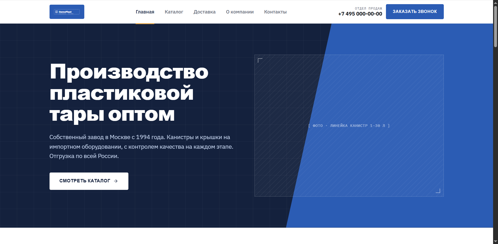
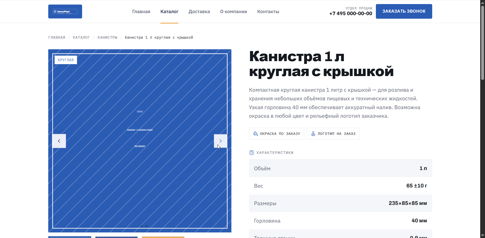
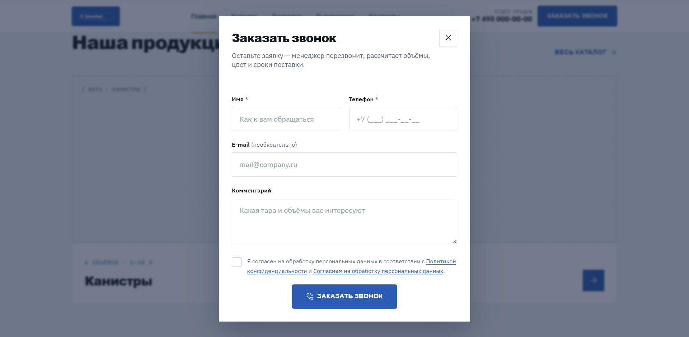
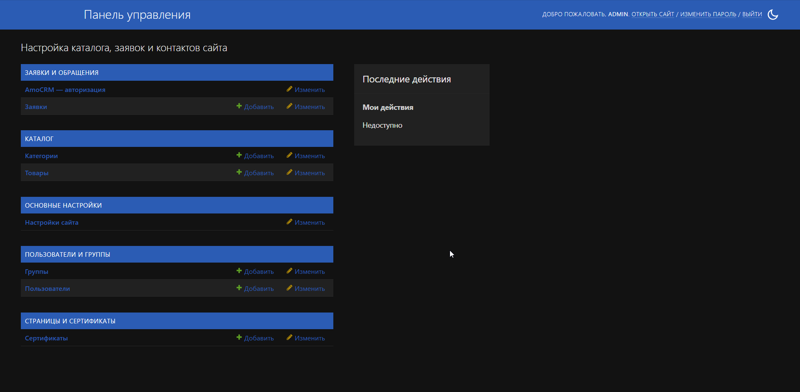

# DemoPlast

> Сайт-каталог производителя пластиковой тары с лидогенерацией: серверный рендеринг на Django 5.

[](https://github.com/Skerter/django-plastic-landing/actions/workflows/test.yaml)
[](pyproject.toml)
[](pyproject.toml)
[](LICENSE)

**Живое демо:** [demoplast.skerter.dev](https://demoplast.skerter.dev) ·
**Документация:** [skerter.github.io/django-plastic-landing](https://skerter.github.io/django-plastic-landing/) ·
**Язык:** [English](README.md) · Русский

Каталог на шесть страниц с формами заявок на HTMX, веером фоновых уведомлений
(email, Telegram, amoCRM) и требованиями 152-ФЗ, встроенными в поток обработки формы.
Локально поднимается одной командой `docker compose up` и сам наполняет себя демо-данными;
боевая версия работает на VPS за Traefik с автоматическим деплоем из CI.

Репозиторий — обезличенная витрина реального коммерческого проекта. Данные заказчика
заменены вымышленной компанией «ДемоПласт»: архитектура и инженерные решения сохранены,
клиент не раскрывается.

---

## Скриншоты

| Главная | Карточка товара |
|---|---|
|  |  |

| Форма заявки | Админ-панель |
|---|---|
|  |  |

---

## Инженерные решения

**Лид сначала в БД, потом в CRM.** Локальная база — source of truth: заявка сохраняется
до любого внешнего вызова, пуш в amoCRM идёт асинхронно после. Падение CRM или протухший
OAuth-токен не теряют заявку и не блокируют ответ пользователю.
([ADR-0005](docs/adr/0005-write-lead-to-db-first.md),
[apps/leads/views.py](apps/leads/views.py), [apps/leads/tasks.py](apps/leads/tasks.py))

**Изолированные каналы уведомлений.** Email, Telegram и amoCRM — три независимые задачи
django-q2 с нативными ретраями; падение одного канала не влияет на остальные. Каналы
включаются флагами в админке, выключенный даже не ставится в очередь.
([apps/leads/services/](apps/leads/services/))

**Соответствие 152-ФЗ.** Политика конфиденциальности и согласие на обработку ПДн — два
отдельных документа, как требует закон. Чекбокс согласия не предзаполнен и валидируется
на бэкенде, факт согласия фиксируется с меткой времени. Аналитика не грузится до согласия
на cookie (решение принимается на сервере в шаблоне), собираются только имя и телефон.
Скруббер Sentry `before_send` вырезает имена, телефоны и тела форм до отправки события.
([config/sentry.py](config/sentry.py), [объяснение](docs/explanation/compliance-152fz.md))

**Защита форм.** Honeypot-поле, `django-ratelimit` на 5 заявок в час с IP с честным `429`,
который HTMX корректно свапает, CSRF на всех формах, в проде — `SECURE_SSL_REDIRECT`,
HSTS и secure-куки.

**Демо-режим.** При `DEMO_MODE=True` все внешние интеграции пропускаются и только пишут
в лог `demo, skipped` — публичное демо работает без единого реального ключа, при этом весь
путь «форма → валидация → лид → админка» остаётся рабочим.

**Mobile-first вёрстка.** От мобильного к десктопу через брейкпоинты Tailwind: бургер-меню,
сетка каталога 1 → 2 → 3 колонки, тач-зоны не меньше 44px, кликабельные `tel:`-ссылки.

---

## Стек

| Технология | Обоснование |
|---|---|
| Django 5, монолит | Шесть страниц и форма не требуют микросервисов; SSR держит каталог индексируемым. ([ADR-0001](docs/adr/0001-monolith-not-microservices.md), [ADR-0003](docs/adr/0003-ssr-not-spa.md)) |
| PostgreSQL 16 | Основное хранилище и ORM-брокер очереди задач — без отдельного Redis. |
| HTMX | Отправка форм, вывод ошибок и реакция на лимит — HTML-фрагментами, без JS-фреймворка. |
| Tailwind v4 (`django-tailwind` + standalone-бинарь) | Дизайн-система собирается на этапе сборки, а не тянется с CDN; Node на сервере не нужен. ([ADR-0004](docs/adr/0004-tailwind-compiled-not-cdn.md)) |
| django-q2 | Фоновые задачи уведомлений и пуша в CRM на ORM-брокере. |
| django-solo | Синглтон `SiteSettings` — контакты и реквизиты правятся в админке, а не в коде. |
| Sentry | Мониторинг ошибок в проде со скруббером персональных данных. |
| uv | Управление зависимостями и venv; `uv.lock` фиксирует воспроизводимую сборку. |
| Docker, Traefik, GitHub Actions | Воспроизводимое окружение, автоматический TLS от Let's Encrypt, сборка образа → GHCR → деплой по SSH. |

---

## Запуск

### Требования

Docker с Compose. Больше ничего — Python, Node и Tailwind живут внутри образа.

### Старт

```bash
cp .env.example .env
docker compose up --build
```

Открыть <http://localhost:8000>.

Последовательность старта полностью автоматическая:

1. [entrypoint.sh](entrypoint.sh) ждёт PostgreSQL, затем выполняет `migrate` и `collectstatic`.
2. Сид-миграции заливают каталог (2 категории, 9 товаров со спеками) и `SiteSettings`.
3. `tailwind build` собирает дизайн-систему.
4. `seed_demo_images` рисует плейсхолдер-фото товаров, по три ракурса, чтобы карусель работала.
5. `seed_demo_leads` создаёт демо-заявки, чтобы админка не была пустой.
6. Поднимается dev-сервер на порту 8000.

Демо-контент генерируется, а не коммитится: `media/` в `.gitignore`, каталог приходит
из миграций, картинки и заявки — из management-команд.

Доступ в админку на <http://localhost:8000/admin/>:

```bash
docker compose exec web python manage.py createsuperuser
```

### Локальная разработка без Docker

`config.settings.dev` использует SQLite, печатает письма в консоль, отключает ratelimit
и принудительно ставит `DEMO_MODE=False`, чтобы прогонять реальный путь уведомлений.

```bash
uv sync --extra dev
uv run python manage.py migrate --settings=config.settings.dev
uv run python manage.py runserver --settings=config.settings.dev
```

---

## Конфигурация

Вся конфигурация — через переменные окружения. [.env.example](.env.example) — шаблон,
реальный `.env` в `.gitignore`. Полный справочник переменных:
[docs/reference/environment.md](docs/reference/environment.md).

| Переменная | Назначение |
|---|---|
| `DJANGO_SETTINGS_MODULE` | Модуль настроек: `config.settings.dev`, `.docker` или `.prod`. |
| `SECRET_KEY`, `DEBUG`, `ALLOWED_HOSTS` | Базовые настройки Django. |
| `DATABASE_URL` | DSN подключения к PostgreSQL. |
| `DEMO_MODE` | `True` отключает все внешние вызовы. |
| `SENTRY_DSN` | Включает мониторинг ошибок; пустое значение — выключен. |
| `EMAIL_*`, `DEFAULT_FROM_EMAIL` | SMTP-отправитель. Получатели задаются в админке. |
| `TELEGRAM_BOT_TOKEN` | Бот для уведомлений. `chat_id` задаётся в админке. |
| `AMOCRM_*` | Креды интеграции с amoCRM и выбор воронки/этапа. |

---

## Тесты

```bash
uv sync --extra dev
uv run pytest -v
```

Покрыто: валидация и сохранение лид-формы, устойчивость каналов уведомлений, диспетчер
задач, сервисы email/Telegram/amoCRM с моками сетевых клиентов, вьюхи каталога и страниц,
`SiteSettings` и аналитика по cookie-согласию, скруббер Sentry. Тестовые данные строятся
через factory_boy ([tests/factories.py](tests/factories.py)). Линт и тесты гоняются на
каждый push и pull request в `main` ([.github/workflows/test.yaml](.github/workflows/test.yaml)).

---

## Деплой

Боевая версия работает на Selectel VDS за общим Traefik, который сам выдаёт и продлевает
сертификаты Let's Encrypt. Стек в [deploy/selectel/](deploy/selectel/) — три сервиса:
`web` (Django на gunicorn), `db` (PostgreSQL) и `media` (nginx только для `/media/`).
Статику раздаёт WhiteNoise внутри `web`.

Push в `main` запускает [.github/workflows/deploy.yaml](.github/workflows/deploy.yaml):
сборка образа, пуш в GHCR как `ghcr.io/skerter/django-plastic-landing`, затем деплой по SSH
через `git reset --hard`, `compose pull` и `up -d`. Секреты хранятся в GitHub Secrets.

Рунбуки: [деплой](docs/how-to/deploy.md) · [эксплуатация](docs/how-to/operations.md).

---

## Структура проекта

<details>
<summary>Дерево каталогов</summary>

```
django-plastic-landing/
├── manage.py
├── compose.yaml              # локальное демо: web + db
├── Dockerfile                # одностадийный; Tailwind собирается на build
├── entrypoint.sh             # ждёт БД, выполняет migrate + collectstatic
├── pyproject.toml, uv.lock   # зависимости и конфиг инструментов (uv)
├── mkdocs.yml                # конфиг сайта документации
├── .env.example              # шаблон локального окружения (DEMO_MODE=True)
├── LICENSE, SECURITY.md
├── .github/workflows/        # CI: test.yaml, deploy.yaml, docs.yaml
├── config/
│   ├── settings/             # base, dev, docker, prod
│   ├── sentry.py             # before_send-скруббер персональных данных
│   └── urls.py, wsgi.py, asgi.py
├── apps/
│   ├── catalog/              # Category, Product, ProductSpec, ProductImage, sitemaps
│   ├── leads/                # Lead, формы, services/ (mail, telegram, amocrm), tasks
│   ├── pages/                # статические страницы, Certificate, SEO
│   └── core/                 # SiteSettings (solo), context processor, cookie-согласие
├── templates/                # base, partials и страницы (Django templates + HTMX)
├── theme/                    # django-tailwind: @theme и компонентная CSS
├── static/                   # demoplast.css, site.js, htmx.min.js, стили админки, img/
├── scripts/                  # скриншоты, подготовка фото и сертификатов
├── deploy/selectel/          # прод-стек: compose.yaml, nginx-media.conf, .env.example
├── docs/                     # Diátaxis-документация, ADR, скриншоты
└── tests/                    # pytest: catalog, core, leads, pages, sentry
```

</details>

---

## Документация

Полная техническая документация построена по модели [Diátaxis](https://diataxis.fr/) —
уроки, инструкции, справочник и объяснения — плюс шесть ADR с обоснованием ключевых
решений. Собирается через MkDocs Material и публикуется на GitHub Pages из CI при каждом
push в `main`.

```bash
uv run --extra docs mkdocs serve
```

Точка входа: [docs/index.md](docs/index.md). Ключевые страницы:
[запуск локально](docs/tutorials/getting-started.md),
[деплой](docs/how-to/deploy.md), [эксплуатация](docs/how-to/operations.md),
[архитектура](docs/explanation/architecture.md),
[модель данных](docs/reference/data-model.md),
[переменные окружения](docs/reference/environment.md),
[ADR](docs/adr/README.md).

---

## Безопасность

Как сообщать об уязвимостях и какие версии поддерживаются: [SECURITY.md](SECURITY.md).

---

## Лицензия

[MIT](LICENSE).
