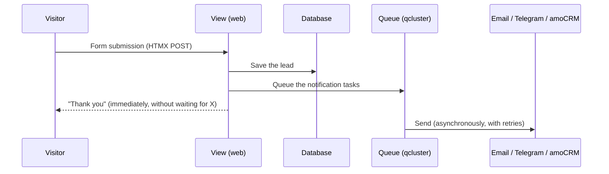

# Architecture

This section explains how the project is built and **why** it is built that way.
If you need to get something done, see the [how-to guides](../how-to/deploy.md);
here you get the whole picture and the reasoning behind the decisions.

## What this application is

A catalog site with lead generation: a visitor browses the products and submits a lead
(a callback or an order). It is **not an online shop** — there is no cart, no payment,
no prices, no customer account. The goal of every page is to lead to a submission.

The audience is the Russian B2B market, so two requirements outrank the rest:
**SEO** (search engines must index the site well) and **152-FZ compliance**
(the personal data law). Both shaped the architecture heavily —
see [152-FZ compliance](compliance-152fz.md).

## A Django monolith

The application is a single Django project with server-side rendering (the HTML is
assembled on the server from templates), not an SPA and not a set of microservices.
Form interactivity is built with HTMX — targeted requests without a heavy frontend.

The reasoning splits into three separate decisions, each with its own analysis:

- [ADR 0001 — Monolith, not microservices](../adr/0001-monolith-not-microservices.md)
- [ADR 0002 — docker-compose, not Kubernetes](../adr/0002-compose-not-k8s.md)
- [ADR 0003 — Server-side rendering, not an SPA](../adr/0003-ssr-not-spa.md)

In short: the project is small (a handful of pages plus forms) while SEO is critical.
A monolith with SSR is simpler, cheaper to operate and better indexed. There is nothing
to justify the extra complexity.

## Apps and layers

The code is split into four Django apps by area of responsibility:

| App | Responsible for |
|---|---|
| `apps.catalog` | Categories, products, specs, photos; the sitemap |
| `apps.leads` | Leads, the form, the integrations (email/Telegram/amoCRM) |
| `apps.pages` | Static pages, certificates, robots.txt |
| `apps.core` | Site settings (singleton), cookie consent, the context processor |

Inside them the principle is **thin views, fat models, logic in the service
layer**. The business logic of the integrations is isolated in `apps/leads/services/`
(`mail.py`, `telegram.py`, `amocrm.py`) instead of being smeared across the views. The
lead view ([`apps/leads/views.py`](https://github.com/Skerter/django-plastic-landing/blob/main/apps/leads/views.py))
only validates the form, saves the lead and queues the tasks — all the work with
external APIs lives in the services.

This buys testability (a service is mocked separately from HTTP) and keeps the view
independent of the details of any particular CRM.

## The lead processing flow

The most important logic in the project is how a lead is processed. The key principle:
**the lead is written to our own database first, and only then sent to external systems**
([ADR 0005](../adr/0005-write-lead-to-db-first.md)).

Why exactly this way:

- **The lead is never lost.** The database is the source of truth. Even if every external
  channel fails, the lead is already saved and visible in the admin.
- **The form does not wait for external services.** The "thank you" is returned at once;
  the fan-out runs in the background (`qcluster`). The user does not hang while amoCRM
  is thinking.
- **One channel failing does not break the others.** Each channel is an independent
  task; a failure is isolated and retried. More on the setup —
  [Notification channels](../how-to/enable-notification-channels.md).

## Configuration without code

Contacts, legal details, texts and notification parameters are edited in the admin
rather than in the code. That is what the `SiteSettings` singleton is for (a single
database record), passed into every template through a context processor
([`apps/core/context_processors.py`](https://github.com/Skerter/django-plastic-landing/blob/main/apps/core/context_processors.py)).
This lets the client change a phone number or an address without a developer. The full
set of fields — [Data model](../reference/data-model.md).

## SEO

SEO is built into several places:

- **Server-side rendering** — the crawler sees ready HTML (see ADR 0003).
- **`sitemap.xml`** is generated from the active categories and products
  (`apps/catalog/sitemaps.py`).
- **Meta tags** come from model fields (`meta_title`, `meta_description`).
- **Mobile-first markup** — search engines index mobile-first.

## Per-environment settings

The Django settings are split into files for different environments, all inheriting a
common base:

| File | Environment |
|---|---|
| `config/settings/base.py` | Shared by everything |
| `config/settings/dev.py` | Local development (SQLite, emails to the console) |
| `config/settings/docker.py` | Development in Docker (Postgres on the `db` host) |
| `config/settings/prod.py` | Production (Postgres, security flags, Sentry, SMTP) |

Which variables each environment reads — [Environment variables](../reference/environment.md).

## Production and deployment

In production: a single VPS, Docker Compose, two stacks (the application plus Traefik as
the reverse proxy with automatic TLS). The image is built in CI and pulled onto the server.
The production layout with a diagram and a step-by-step rollout —
[Deploy](../how-to/deploy.md).
