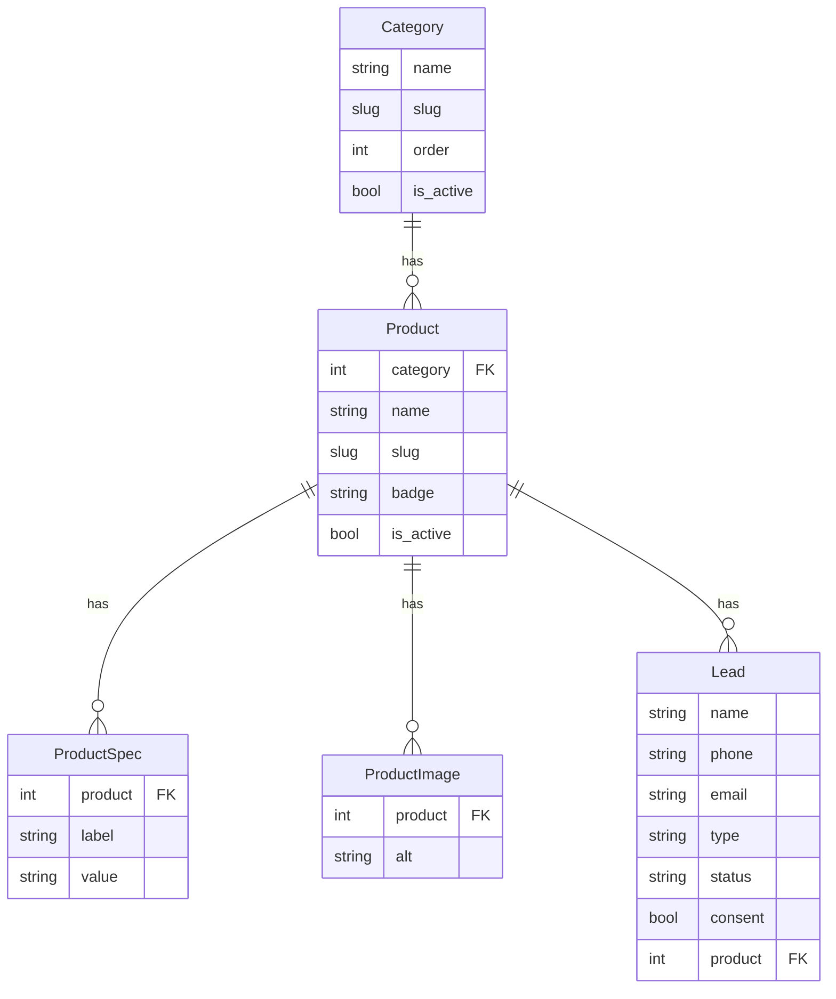

# Data model

A reference of every database model (the data dictionary). The source is the
`models.py` of the `catalog`, `leads`, `pages` and `core` apps.

The **Field** column holds the name used in the code and the database. Fields marked
`blank` may be empty in a form; fields marked `null` may be `NULL` in the database.

## Relationship diagram

`SiteSettings`, `AmoCRMAuth`, `Certificate` and `Page` have no relations
(singletons and standalone galleries) — they are not shown on the diagram.

---

## Catalog (`apps.catalog`)

### Category — a catalog category

| Field | Type | Empty? | Description |
|---|---|---|---|
| `name` | CharField(200) | no | The title. |
| `slug` | SlugField | no, unique | Part of the URL. |
| `image` | ImageField | blank | The section picture (`categories/`). |
| `order` | PositiveInteger | default 0 | The sort order. |
| `is_active` | Boolean | default True | Show on the site. |

Default ordering: `order`, then `name`.

### Product — a product

| Field | Type | Empty? | Description |
|---|---|---|---|
| `category` | FK → Category | no | The category. On category deletion — **PROTECT** (it cannot be deleted while it has products). |
| `name` | CharField(200) | no | The title. |
| `slug` | SlugField | no, unique | Part of the URL. |
| `badge` | CharField(50) | blank | The label over the photo ("Евроканистра"). |
| `description` | TextField | blank | The description. |
| `image` | ImageField | blank | The main photo (`products/`). |
| `is_active` | Boolean | default True | Show on the site. |
| `order` | PositiveInteger | default 0 | The order. |
| `meta_title` | CharField(200) | blank | The SEO title. |
| `meta_description` | CharField(300) | blank | The SEO description. |

### ProductSpec — a product spec

"Parameter → value" pairs. The set differs from product to product (hence free-form
fields rather than fixed columns).

| Field | Type | Empty? | Description |
|---|---|---|---|
| `product` | FK → Product | no | The product. On product deletion — **CASCADE**. |
| `label` | CharField(100) | no | The parameter ("Объём"). |
| `value` | CharField(200) | no | The value ("20"). |
| `unit` | CharField(50) | blank | The unit ("л"). |
| `order` | PositiveInteger | default 0 | The order. |

### ProductImage — a product photo

| Field | Type | Empty? | Description |
|---|---|---|---|
| `product` | FK → Product | no | The product. **CASCADE**. |
| `image` | ImageField | no | The file (`products/`). |
| `alt` | CharField(200) | blank | The caption/angle. Used as the alt text and the thumbnail caption. |
| `order` | PositiveInteger | default 0 | The position in the gallery. |

---

## Leads (`apps.leads`)

### Lead — a lead from the site

| Field | Type | Empty? | Description |
|---|---|---|---|
| `name` | CharField(200) | no | The name. |
| `phone` | CharField(20) | no | The phone number. |
| `email` | EmailField | blank | The e-mail. |
| `comment` | TextField | blank | The comment. |
| `type` | CharField, choices | default `order` | The type: `callback` / `order`. |
| `status` | CharField, choices | default `new` | The status: `new` / `processed`. |
| `consent` | Boolean | no | The fact of personal data processing consent. |
| `created_at` | DateTime | auto | The creation timestamp (set automatically). |
| `product` | FK → Product | null, blank | The product the lead is about. On product deletion — **SET_NULL**. |

Default ordering: `created_at` descending (newest first).
The `as_message()` method formats a lead into notification text.

### AmoCRMAuth — the amoCRM tokens (singleton)

Stores the integration's OAuth tokens. A single record.

| Field | Type | Description |
|---|---|---|
| `access_token` | TextField | The access token. |
| `refresh_token` | TextField | The refresh token. |
| `expires_at` | DateTime | The access token's expiry. |

The tokens are created by the `amocrm_auth` command and refreshed automatically. In the
admin they are read-only.

---

## Pages (`apps.pages`)

### Certificate — a certificate

A standalone image gallery on the "About" page.

| Field | Type | Empty? | Description |
|---|---|---|---|
| `title` | CharField(200) | no | The title. |
| `image` | ImageField | no | The scan or photo (`certificates/`). |
| `order` | PositiveInteger | default 0 | The order. |
| `is_active` | Boolean | default True | Show it. |

---

## Site settings (`apps.core`)

### SiteSettings — the site settings (singleton)

A single record, edited in the admin. Contacts, legal details and notification
parameters. Every field is described in full by its `help_text` in the admin.

**Contacts:** `company_name`, `phone_sales`, `phone_sales_person`,
`email_sales`, `phone_production`, `phone_production_person`,
`phone_accounting`, `email_accounting`.

**Address and hours:** `address`, `work_hours`, `work_hours_weekend`, `map_query`.

**Legal details:** `legal_address`, `inn`, `kpp`, `ogrn`, `okpo`, `account`,
`bank`, `bik`, `corr_account`.

**Notifications and analytics:** `metrika_id`, `notify_email_enabled`,
`email_notifications`, `notify_telegram_enabled`, `telegram_chat_id`,
`notify_amocrm_enabled`.

!!! note "Phone numbers: one field, two uses"
    A phone number is stored in a single field in its display form (`+7 495 000-00-00`).
    The clickable `tel:` link is derived automatically by the `phone_*_tel`
    properties — there is no need to store it separately, and the display value
    and the href cannot drift apart.

Why `email_sales` and `email_notifications` are separate — see
[Notification channels](../how-to/enable-notification-channels.md).
